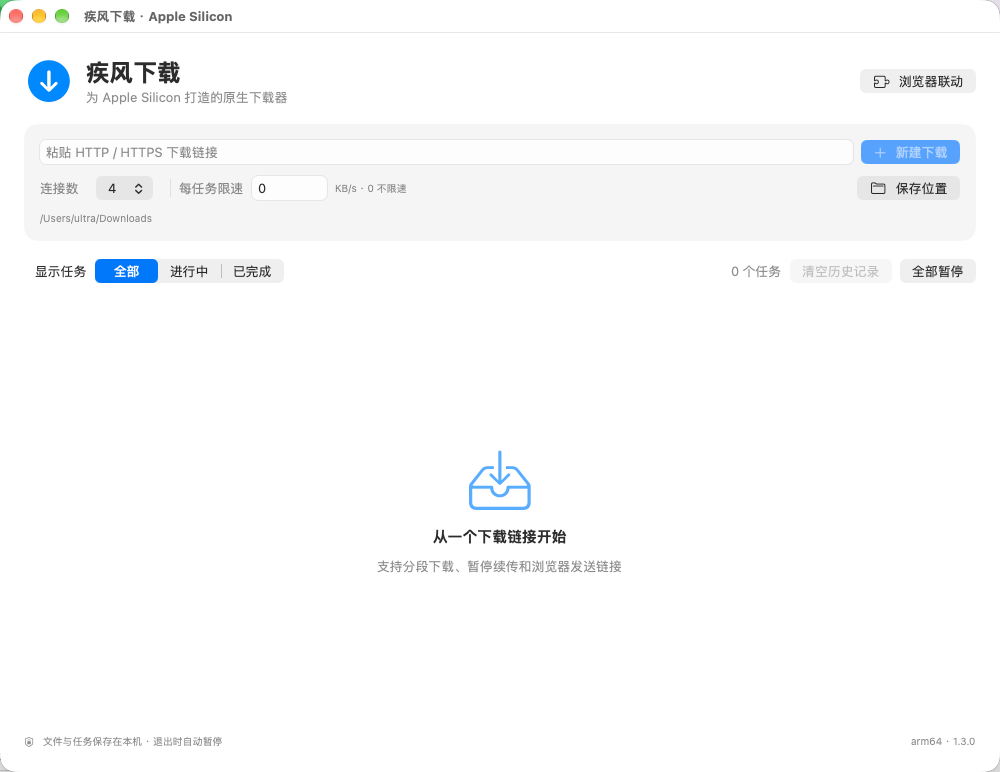
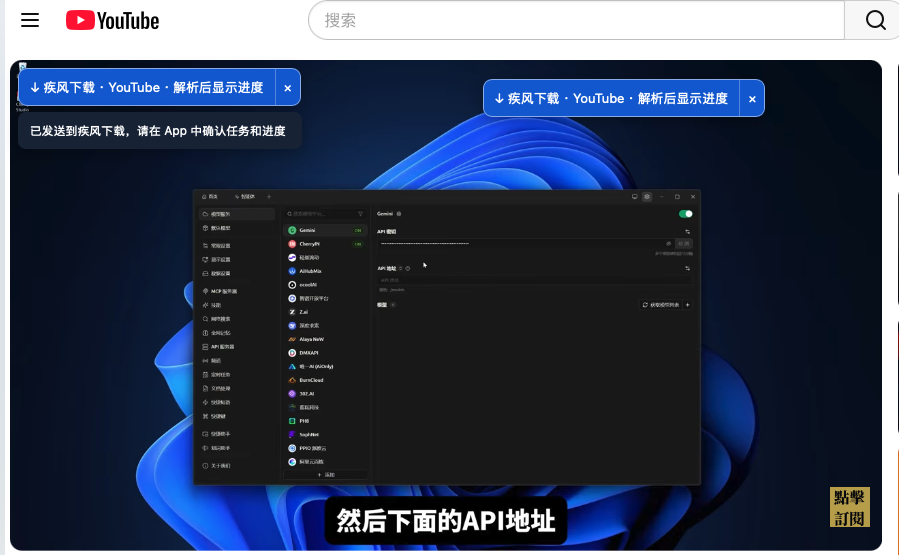
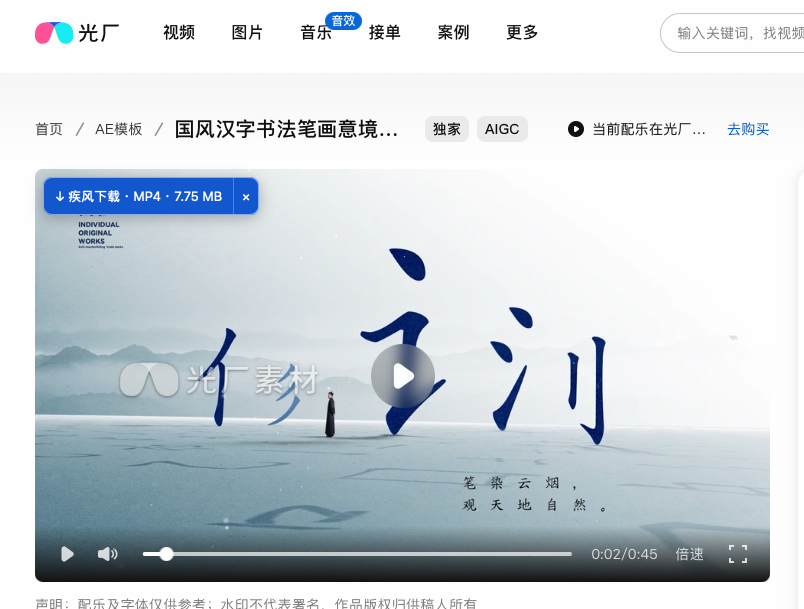
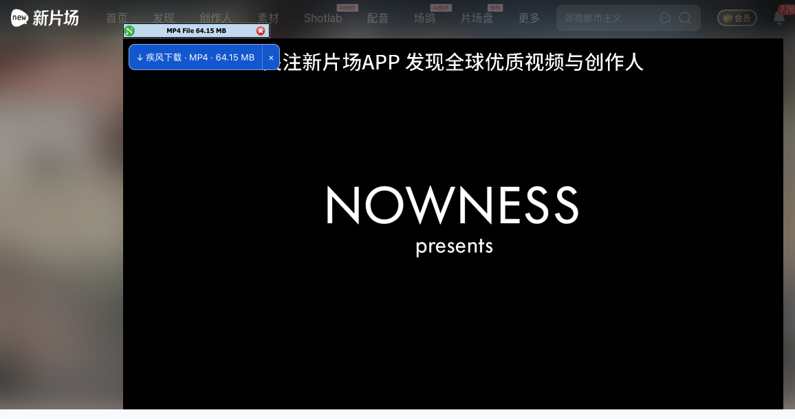

<p align="center"></p>
<h1 align="center">疾风下载 · Jifeng Download</h1>
<p align="center">为 Apple Silicon Mac 打造的原生下载器</p>

[下载安装包](https://github.com/mrbean2050/jifeng-download/releases) · [问题反馈](https://github.com/mrbean2050/jifeng-download/issues)

## 下载与安装

适用于 **Apple Silicon（M 系列）Mac，macOS 13 或更新版本**。Intel、Windows 和手机不支持。

打开 Releases，下载 `JifengDownload-1.3.0-AppleSilicon.dmg`，把“疾风下载”拖入“应用程序”。安装包内置视频解析、JavaScript 运行环境和音画合并工具，**无需另装 Homebrew、Python、yt-dlp 或 FFmpeg**。

**当前为未公证测试版**：尚未完成 Apple Developer ID 发行签名与公证，其他 Mac 可能阻止首次打开。不要关闭系统安全保护；如果系统阻止且无法正常打开，请等待已公证正式版。不能将本版本等同于无提示、双击即用的正式发行版。

## 功能

- HTTP/HTTPS 文件下载，1/2/4/8 分段、限速、暂停、恢复。
- 同名文件另存，不覆盖已有文件；本机保存任务历史。
- 清空已完成和已取消的记录，保留下载文件及未完成任务。
- Chrome/Edge 助手发送链接、右键菜单、普通下载接管；Brave、Vivaldi、Opera 提供兼容连接配置，尚未实机验证。
- Firefox 适配助手作为开发版提供，尚未实机验证及通过 Mozilla 签名。
- 获准网页的播放器旁显示视频下载按钮，直链视频可查询大小。
- YouTube 单视频解析、下载与音画合并，默认保存 MKV。

## 浏览器联动

App 本身可以直接粘贴下载链接使用。浏览器按钮需要另行加载助手并授予网站权限，不能由 App 静默安装。

### Chrome / Edge / Brave / Vivaldi / Opera

1. App →“浏览器联动”→“启用本机通信”。
2. 点击“打开助手文件夹”。
3. 浏览器扩展页打开开发者模式，加载该文件夹。
4. 助手中点击“检查连接”。需要视频按钮时，点击“所有网站显示视频按钮”并确认网站权限。

自动接管默认关闭。重新加载扩展后，需要刷新原来的网页。

### Safari

Safari 助手已经内置在同一个“疾风下载.app”中，不再安装第二个 App。打开疾风下载 → 浏览器联动 →“Safari 扩展设置”。

当前公开测试版未完成发行签名，Safari 可能不列出、不能启用或需开发者设置；**不能保证其他 Mac 上 Safari 下载即用**。本机开发证书验证通过不代表公开分发有效。遇到系统拒绝时请等待正式签名版，不要关闭系统保护。

### Firefox

App 内提供“Firefox 助手文件夹”，采用 Firefox 的扩展标识和本机通信配置。当前未通过 Mozilla 签名，只供开发测试；正式长期安装需要商店或未列出扩展签名。没有实机验证，不作为已验证支持宣称。

一个 App 负责全部任务，但每个浏览器仍需单独安装或启用助手、确认网站权限；不支持任意第三方浏览器或手机浏览器。

## 界面预览

### App


### YouTube


### 光厂


### 新片场


截图由项目维护者提供，演示具体页面的实际界面；不代表支持所有网站或可取得原始素材文件。

## 隐私与限制

不读取浏览器 Cookie 或账号资料，不上传本机下载历史。查询视频大小会向视频服务器读取响应头。浏览器网站权限允许读取网页内容，仅在确认后开启。

不处理 DRM；需要登录、地区限制、过期链接或服务器拒绝的内容可能失败。其他网站的 blob/HLS/DASH 视频暂不通用支持。YouTube 按钮不预估大小，解析后在 App 显示进度。只保存当前网页实际提供的可访问视频，不承诺原片画质。

## 从源码构建

需要 Apple Silicon Mac、Xcode 和系统 Python 3。

```sh
python3 scripts/prepare-runtime.py
bash scripts/build-safari.sh
SAFARI_EXTENSION_PATH="$PWD/build/safari-extension/疾风下载Safari助手 Extension.appex" OUTPUT_DIR="$PWD/build" ./build.sh
Tests/run.sh
```

首次准备会从官方来源下载固定版本工具，并从随发布提供的原始源码编译用于本地合并的精简 FFmpeg。运行时不依赖 Homebrew。`Runtime/` 和 `build/` 不提交到代码仓库。

## 第三方软件

内置 yt-dlp 2026.08.19、Deno 2.9.7、FFmpeg 8.0.1。组件各自遵循其许可证，详见 `ThirdParty/`。FFmpeg 编译配置和对应源码包随发行版提供；FFmpeg 仅作独立的命令行子进程运行。源码下载地址和校验值记录于准备脚本。

项目与 NeatDownloadManager、YouTube、光厂、新片场无隶属或合作关系。
